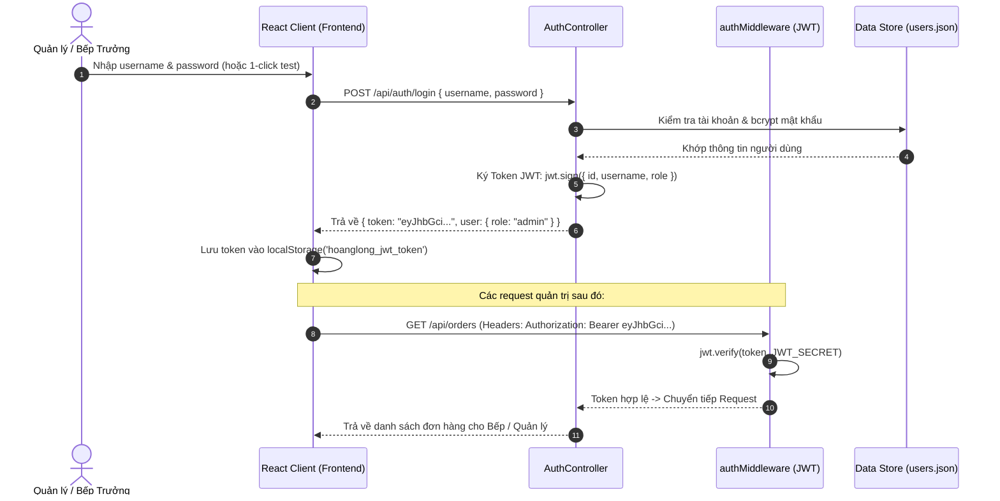
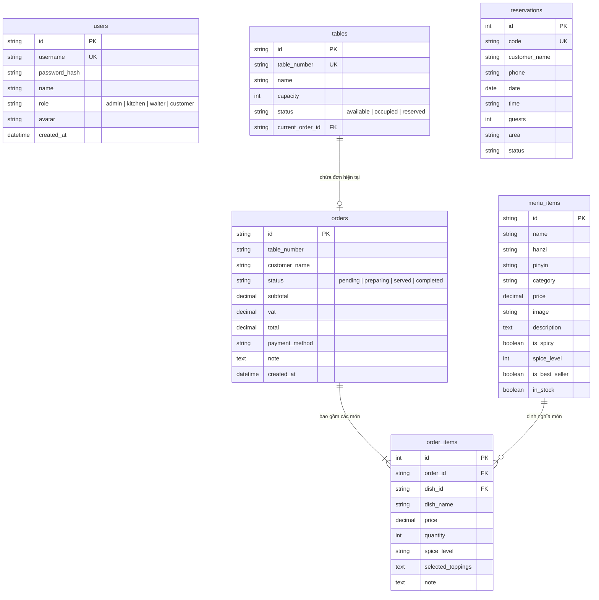

# 🏮 HOÀNG LONG QUÁN (皇龍樓) - HỆ THỐNG GỌI MÓN TẠI BÀN QUA MÃ QR

> **Dự án Web App Nhà Hàng Ẩm Thực Trung Hoa Đệ Nhất**
> Áp dụng kiến thức **HTML5 & CSS3**, **JavaScript ES6+**, **ReactJS**, kiến trúc chuẩn **MVC (Model - View - Controller)** và cơ chế bảo mật **JWT (JSON Web Token)**.

---

## 📖 1. Giới Thiệu & Bài Toán Nghiệp Vụ

Khi khách hàng bước vào **Hoàng Long Quán**, mỗi bàn ăn đều được trang bị một **Mã QR định danh riêng biệt** (Bàn 01 đến Bàn 12, Phòng VIP 01, VIP 02). 

Khách hàng chỉ cần quét mã QR bằng camera điện thoại:
1. **Truy cập trực tiếp thực đơn bàn**: Hệ thống nhận diện số bàn (ví dụ `?table=08`) mà khách không cần cài đặt ứng dụng.
2. **Khám phá ẩm thực Trung Hoa đặc sắc**: Dim Sum Quảng Đông, Vịt quay Bắc Kinh, Lẩu Tứ Xuyên cay tê 2 ngăn, Mì kéo Lan Châu, Trà Long Tỉnh...
3. **Tùy biến món ăn**: Chọn độ cay (Không cay, Cay dịu, Siêu cay Tứ Xuyên), thêm topping gia vị, ghi chú đặc biệt cho đầu bếp ("Ít dầu", "Không hành ngò").
4. **Gửi đơn đặt món (Order)**: Đơn chuyển thẳng vào hệ thống **KDS (Kitchen Display System)** của Nhà Bếp.
5. **Theo dõi trạng thái đơn hàng thời gian thực**: *Bếp nhận đơn 🕒 ➔ Đang nổi lửa nấu 🔥 ➔ Tiểu nhị lên món 🍽️ ➔ Hoàn tất ✨*.
6. **Rung chuông gọi phục vụ**: Châm thêm nước lẩu, xin sốt sa tế Triều Châu, khăn lạnh hoặc yêu cầu mang hóa đơn thanh toán.

---

## 🏛️ 2. Kiến Trúc Thư Mục Hiện Đại (Modern Architecture)

Dự án được phân tách độc lập giữa **Server (Node.js/Express MVC)** và **Client (React SPA)**, tuân thủ chặt chẽ nguyên lý Single Responsibility.

```
Restfolder_WebSite/
├── server/                          # BACKEND: RESTful API Kiến trúc MVC & JWT
│   ├── config/
│   │   └── config.js                # Thiết lập cổng PORT, mã bí mật JWT_SECRET, đường dẫn dữ liệu
│   ├── models/                      # [M] MODEL - Cấu trúc dữ liệu & Xử lý nghiệp vụ kho dữ liệu
│   │   ├── userModel.js             # Tài khoản, mã hóa băm mật khẩu bcrypt, phân quyền
│   │   ├── menuItemModel.js         # Món ăn Trung Hoa, phân loại, trạng thái hết hàng (inStock)
│   │   ├── orderModel.js            # Đơn hàng từng bàn, tiến trình bếp nấu, gọi phục vụ
│   │   └── tableModel.js            # Quản lý số bàn, sinh mã hình ảnh QR tự động
│   ├── controllers/                 # [C] CONTROLLER - Tiếp nhận Request & Phản hồi Response
│   │   ├── authController.js        # Đăng ký, Đăng nhập, cấp phát JWT Token
│   │   ├── menuController.js        # Lấy danh sách món, lọc cay/bán chạy, CRUD món
│   │   ├── orderController.js       # Khách đặt món, Bếp cập nhật trạng thái đơn
│   │   └── tableController.js       # Lấy thông tin bàn, tạo mã QR theo bàn
│   ├── routes/                      # API Endpoints Router
│   │   ├── authRoutes.js            # /api/auth (login, register, me, demo-accounts)
│   │   ├── menuRoutes.js            # /api/menu (GET, POST, PUT, DELETE)
│   │   ├── orderRoutes.js           # /api/orders (POST đặt bàn, PATCH trạng thái)
│   │   └── tableRoutes.js           # /api/tables (GET bàn, GET QR code)
│   ├── middlewares/                 # Middlewares trung gian
│   │   ├── authMiddleware.js        # Xác thực Bearer Token JWT
│   │   ├── roleMiddleware.js        # Phân quyền Admin / Kitchen / Waiter
│   │   └── errorMiddleware.js       # Bắt lỗi toàn cục 404 & 500
│   ├── utils/
│   │   └── jwtHelper.js             # Hàm ký sinh (sign) & giải mã (verify) JWT Token
│   ├── data/                        # JSON Data Store (Mô phỏng cơ sở dữ liệu bền vững)
│   │   ├── users.json
│   │   ├── menu.json
│   │   ├── orders.json
│   │   └── tables.json
│   ├── server.js                    # Entrypoint máy chủ Express (Port 5000)
│   └── package.json
│
├── client/                          # FRONTEND: [V] VIEW - React 18 + Vite Phong Cách Trung Hoa
│   ├── index.html                   # Tích hợp Google Fonts Thư Pháp Hán Nôm & Chữ Viết
│   ├── vite.config.js               # Cấu hình Vite & Proxy API về backend
│   ├── src/
│   │   ├── styles/
│   │   │   └── index.css            # CSS Chu Sa Đỏ, Hoàng Kim Lạc, Đèn lồng đung đưa, Hồi văn
│   │   ├── api/                     # Tầng kết nối REST API (HTTP Client)
│   │   │   ├── apiClient.js         # Tự động gán Header: Authorization: Bearer <token>
│   │   │   ├── authApi.js           # Đăng nhập & Xác thực thông tin JWT
│   │   │   ├── menuApi.js           # Lấy thực đơn, lọc danh mục
│   │   │   └── orderApi.js          # Gửi đơn gọi món, theo dõi trạng thái bàn
│   │   ├── context/                 # Quản lý trạng thái toàn cục (State Management)
│   │   │   ├── AuthContext.jsx      # Trạng thái đăng nhập JWT, phân quyền tài khoản
│   │   │   ├── TableContext.jsx     # Trạng thái số bàn đang ngồi (từ QR code URL)
│   │   │   └── CartContext.jsx      # Giỏ món ăn, tùy chọn gia vị, tính tiền VAT 8%
│   │   ├── components/              # Thành phần giao diện tái sử dụng
│   │   │   ├── Header.jsx           # Thanh tiêu đề, thông tin bàn, chuông gọi phục vụ
│   │   │   ├── Lanterns.jsx         # Đèn lồng đỏ đung đưa phong thủy cung đình
│   │   │   ├── ChineseSeal.jsx      # Con dấu triện đỏ thư pháp (印章)
│   │   │   ├── CategoryTabs.jsx     # Bộ lọc Dim Sum, Vịt Quay, Lẩu Tứ Xuyên...
│   │   │   ├── DishCard.jsx         # Thẻ hiển thị món ăn chuẩn Trung Hoa
│   │   │   ├── DishDetailModal.jsx  # Modal tùy biến độ cay, topping, ghi chú đầu bếp
│   │   │   ├── CartDrawer.jsx       # Giỏ hàng bên phải, gửi đơn vào bếp (bắn pháo hoa)
│   │   │   ├── QRModal.jsx          # Mô phỏng quét mã QR & tạo mã QR cho từng bàn
│   │   │   ├── OrderTracker.jsx     # Bảng tiến độ theo dõi món ăn trực tiếp
│   │   │   ├── CallStaffModal.jsx   # Gọi tiểu nhị hỗ trợ nước lẩu, nước chấm, tính tiền
│   │   │   └── Footer.jsx           # Chân trang truyền thống
│   │   ├── pages/                   # Các trang màn hình
│   │   │   ├── CustomerMenuPage.jsx # Giao diện chính khách quét QR gọi món
│   │   │   ├── KitchenDashboard.jsx # Màn hình KDS nhà bếp tiếp nhận và đổi trạng thái
│   │   │   ├── TableManagerPage.jsx # Quản lý và in toàn bộ thẻ mã QR để bàn
│   │   │   └── AdminLoginPage.jsx   # Cổng đăng nhập phân quyền JWT
│   │   ├── App.jsx                  # Điều hướng chính ứng dụng
│   │   └── main.jsx                 # Entrypoint React DOM
│   └── package.json
│
├── start-dev.js                     # Script khởi chạy đồng thời cả Server & Client
├── package.json                     # Scripts quản lý tổng
└── README.md
```

---

## 🔐 3. Cơ Chế Xác Thực JWT (JSON Web Token)

Hệ thống bảo mật các thao tác quản trị và điều phối nhà bếp thông qua chuẩn **JWT**:



### 👤 Tài khoản mẫu để kiểm thử nhanh (1-Click Login):
- **Chủ Quán (Admin)**: `username: admin` | `password: 123` (Toàn quyền quản trị, in mã QR, điều phối món)
- **Bếp Trưởng (Kitchen)**: `username: bep` | `password: 123` (Nhận đơn KDS, cập nhật trạng thái nấu)
- **Tiểu Nhị (Waiter)**: `username: phucvu` | `password: 123` (Xem bàn gọi phục vụ, hỗ trợ khách)

---

## 🎨 4. Phong Cách Thiết Kế Trung Hoa (Chinese Traditional Aesthetics)

- **Màu sắc chủ đạo**:
  - Chu Sa Đỏ Cung Đình (`#8B1117`, `#C8102E`): Tượng trưng cho sự may mắn, thịnh vượng và nồng nhiệt.
  - Hoàng Kim Lạc (`#D4AF37`, `#F7D774`): Tượng trưng cho phú quý hoàng gia.
  - Bạch Ngọc Trắng Ngà (`#FFF8EE`): Thanh tao, hài hòa thị giác.
- **Biểu tượng truyền thống**:
  - Đèn lồng đỏ (Red Lanterns) đung đưa nhẹ nhàng với ánh sáng radial glow ấm cúng.
  - Dấu triện son thư pháp (Chinese Seal Stamp 印章) mang tên hiệu *Hoàng Long Quán - 皇龍樓*.
  - Hoa văn góc Hồi văn cổ điển (Chinese Lattice Border Corners).
  - Phông chữ thư pháp Hán tự: *Ma Shan Zheng (马善政)* & chữ Việt chuẩn mực *Be Vietnam Pro*.
- **Thực đơn đặc sắc**:
  - 🥟 **Điểm Tâm Dim Sum**: Há Cảo Thủy Tinh, Xíu Mại Gạch Cua, Bánh Bao Kim Sa Trứng Muối Tan Chảy, Bánh Cuốn Cheung Fun Tôm Tươi...
  - 🦆 **Quay & Nướng Cung Đình**: Vịt Quay Bắc Kinh Da Giòn Thượng Hạng, Heo Sữa Quay Ma Cao, Xá Xíu Mật Ong Thượng Hải.
  - 🍲 **Lẩu & Món Xào Tứ Xuyên**: Lẩu Uyên Ương 2 Ngăn Cay Tê & Gà Thảo Mộc, Đậu Hũ Ma Bà (Mapo Tofu), Gà Cung Bảo.
  - 🍜 **Mì Kéo & Cơm Chiên**: Mì Kéo Tay Bò Lan Châu, Mì Hoành Thánh Xá Xíu, Cơm Chiên Hoàng Kim Dương Châu.
  - 🍵 **Danh Trà & Tráng Miệng**: Trà Long Tỉnh Tây Hồ, Chè Dương Chi Cam Lộ Xoài Bưởi, Bánh Tart Trứng Hong Kong.

---

## 🚀 5. Hướng Dẫn Cài Đặt & Khởi Chạy

### Yêu cầu môi trường:
- Node.js version 18 trở lên (Khuyến nghị Node v20/v24).
- Trình duyệt hiện đại (Chrome, Edge, Safari, Firefox).

### Bước 1: Mở thư mục dự án
```powershell
cd c:\Users\Bear\Documents\Study\Restfolder_WebSite
```

### Bước 2: Cài đặt dependencies (Nếu chưa cài)
```powershell
npm run install:all
```

### Bước 3: Khởi chạy toàn bộ hệ thống (Server + Client cùng lúc)
```powershell
npm run dev
```

Sau khi chạy lệnh:
- **Client (Giao diện Quét QR & Thực Đơn)**: Mở trình duyệt tại 👉 [http://localhost:5173](http://localhost:5173)
- **Server (Express RESTful API)**: Đang chạy tại 👉 [http://localhost:5000/api](http://localhost:5000/api)

---

## 📱 6. Hướng Dẫn Kiểm Thử Tính Năng Quét Mã QR

1. **Vào bàn mặc định**: Khi mở `http://localhost:5173`, hệ thống tự động gán **Bàn 08**.
2. **Thử nghiệm quét bàn khác**:
   - Nhấn vào nút **"Bàn: 08"** trên thanh Header.
   - Hộp thoại xuất hiện: Bạn có thể chọn bàn bất kỳ (ví dụ: Bàn 01, Bàn 03, VIP-01) hoặc bấm **"Quét Thử Bằng Camera"**.
   - URL sẽ tự động cập nhật dạng: `http://localhost:5173/?table=03`.
3. **Thêm món & Tùy biến**:
   - Chọn một món (ví dụ: *Lẩu Tứ Xuyên Uyên Ương*).
   - Chọn mức độ cay: **Cay tê Tứ Xuyên 🔥**.
   - Chọn topping: *Đĩa bò Wagyu nhúng lẩu (+160.000 đ)*.
   - Nhập ghi chú: *"Cho nước lẩu nhiều hoa tiêu"*.
   - Nhấn **"Thêm Vào Thực Đơn"**.
4. **Gửi đơn vào bếp**:
   - Mở giỏ hàng, kiểm tra bảng tính tiền (Tạm tính + Thuế VAT 8%).
   - Nhấn **"GỬI ĐƠN VÀO BẾP 🏮"**.
   - Pháo hoa chúc mừng sẽ bắn lên, hệ thống chuyển sang màn hình **Tiến Độ Món Ăn**.
5. **Kiểm tra màn hình Nhà Bếp (KDS)**:
   - Nhấn nút **"Nhân Viên"** trên góc phải Header.
   - Bấm **1-Click Đăng nhập Bếp Trưởng** (`bep` / `123`).
   - Màn hình KDS hiển thị ngay đơn vừa đặt của Bàn 03!
   - Bếp trưởng bấm **"NHẬN ĐƠN & BẮT ĐẦU NẤU 🔥"** ➔ Màn hình khách hàng lập tức đồng bộ chuyển trạng thái sang *"Đang nổi lửa nấu..."*.

---

## 📬 7. Kiểm Thử API Bằng Postman

Hệ thống cung cấp trọn bộ Postman Collection & Environment chuẩn v2.1 trong thư mục `postman/`:
- `postman/HoangLongQuan_API.postman_collection.json`
- `postman/HoangLongQuan_Environment.postman_environment.json`

| Phương thức | Endpoint | Chức năng | Quyền hạn (JWT) |
|:---|:---|:---|:---|
| **POST** | `/api/auth/login` | Đăng nhập lấy JWT Bearer Token | Public |
| **GET** | `/api/auth/me` | Xem thông tin tài khoản đăng nhập | Cần Token Bearer |
| **GET** | `/api/menu` | Lấy danh sách món ăn (`?category=dimsum&search=vịt`) | Public |
| **POST** | `/api/orders` | Khách gửi đơn đặt món từ bàn (tự tính VAT 8%) | Public |
| **GET** | `/api/orders/table/:num/active` | Xem tiến độ món đang nấu của bàn | Public |
| **PATCH** | `/api/orders/:id/status` | Cập nhật tiến độ: pending ➔ preparing ➔ served ➔ completed | Staff / Kitchen |
| **POST** | `/api/orders/:id/call-staff` | Bấm chuông gọi phục vụ tại bàn | Public |
| **GET** | `/api/tables/all/with-qr` | Lấy danh sách mã QR ảnh base64 của tất cả các bàn | Public / Staff |

---

## 🧪 8. Hệ Thống Kiểm Thử Hoàn Chỉnh (Testing Suite)

Dự án trang bị đầy đủ 2 hình thức kiểm thử:

### A. Kiểm Thử Thủ Công (Manual Testing):
* **Tài liệu ca kiểm thử**: [TEST_CASES_MANUAL.md](file:///c:/Users/Bear/Documents/Study/Restfolder_WebSite/TEST_CASES_MANUAL.md) (40 ca kiểm thử chi tiết).
* **Bảng tính Excel nghiệm thu**: [BANG_KIEM_THU_THU_CONG.csv](file:///c:/Users/Bear/Documents/Study/Restfolder_WebSite/BANG_KIEM_THU_THU_CONG.csv) (UTF-8 BOM không lỗi font).
* **Trang in ấn báo cáo nghiệm thu**: Mở trình duyệt tại 👉 `http://localhost:5173/kiem-thu-thu-cong.html` (có nút in PDF).
* **Sổ tay tương tác trong Web**: Bấm nút **Menu** $\rightarrow$ chọn **"Kiểm Thử API & Postman"** để tự tay đánh dấu [✓ Đạt] / [✗ Lỗi].

### B. Kiểm Thử Tự Động (Automated Testing):
```powershell
# 1. Chạy 26 ca kiểm thử Backend REST API (Node.js Test Runner)
npm run test:api

# 2. Chạy 10 ca kiểm thử Frontend UI Component (Vitest)
npm run test:ui

# 3. Chạy toàn bộ hệ thống kiểm thử
npm test
```

---

## 🗄️ 9. Sơ Đồ Cơ Sở Dữ Liệu Thực Thể (ERD - Entity Relationship Diagram)

Cơ sở dữ liệu MySQL chuẩn hóa UTF-8 (`utf8mb4_unicode_ci`) được lưu tại `database.sql`:


