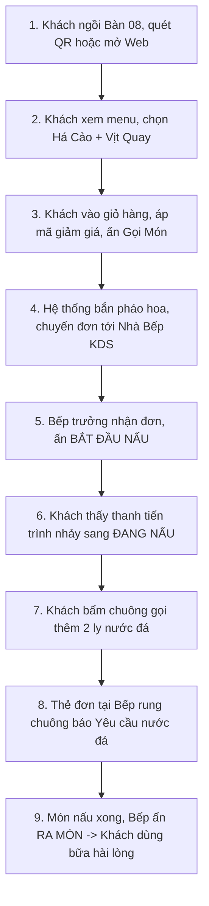

# 📋 TÀI LIỆU KỊCH BẢN TỰ KIỂM THỬ THỦ CÔNG (MANUAL TEST CASES)
## HỆ THỐNG GỌI MÓN NHÀ HÀNG HOÀNG LONG QUÁN (皇龍樓)

* **Loại kiểm thử**: Kiểm thử thủ công (Manual Testing - Black-box Testing)
* **Đối tượng kiểm thử**:
  1. Giao diện người dùng (UI/UX Web & Mobile Responsive)
  2. Hệ thống API Backend qua công cụ Postman
  3. Luồng nghiệp vụ khép kín (End-to-End User Journey)
* **Môi trường thử nghiệm**:
  * Frontend: `http://localhost:5173`
  * Backend API: `http://localhost:5000/api`
  * Trình duyệt khuyến nghị: Google Chrome / Microsoft Edge / Safari

---

## MỤC LỤC
1. [Hướng Dẫn Tự Kiểm Thử Bằng Postman Từng Bước](#1-hướng-dẫn-tự-kiểm-thử-bằng-postman-từng-bước)
2. [Bảng Ma Trận Ca Kiểm Thử API Bằng Postman (TC_API)](#2-bảng-ma-trận-ca-kiểm-thử-api-bằng-postman)
3. [Bảng Ma Trận Ca Kiểm Thử Giao Diện Người Dùng (TC_UI)](#3-bảng-ma-trận-ca-kiểm-thử-giao-diện-người-dùng)
4. [Kịch Bản Tự Kiểm Thử Luồng Nghiệp Vụ Khép Kín (E2E Scenario)](#4-kịch-bản-tự-kiểm-thử-luồng-nghiệp-vụ-khép-kín)

---

## 1. HƯỚNG DẪN TỰ KIỂM THỬ BẰNG POSTMAN TỪNG BƯỚC

### Bước 1: Chuẩn bị Postman
1. Mở phần mềm **Postman** trên máy tính.
2. Nhấn nút **Import** (góc trên bên trái).
3. Chọn tệp `postman/HoangLongQuan_API.postman_collection.json` và `postman/HoangLongQuan_Environment.postman_environment.json`.
4. Tại góc trên bên phải, chọn môi trường: **`Hoàng Long Quán - Localhost Environment`**.

### Bước 2: Cách tự thực hiện một Request thủ công
1. Chọn một request từ danh sách bên trái.
2. Kiểm tra thanh địa chỉ: URL, Phương thức HTTP (`GET`, `POST`, `PUT`, `PATCH`, `DELETE`).
3. Chuyển sang tab **Body** $\rightarrow$ chọn **raw** $\rightarrow$ định dạng **JSON** (nếu là request thêm/sửa).
4. Nhấn nút **Send** màu xanh.
5. Quan sát phần **Response**:
   * **Status Code**: `200 OK`, `201 Created`, `400 Bad Request`, `401 Unauthorized`...
   * **Time**: Thời gian phản hồi (thường `< 100ms`).
   * **Body JSON**: Dữ liệu trả về có đúng tiếng Việt có dấu và chuẩn xác không.

---

## 2. BẢNG MA TRẬN CA KIỂM THỬ API BẰNG POSTMAN

| Mã Ca Test | Tên Chức Năng | Mục Tiêu Kiểm Thử | Các Bước Thực Hiện Bằng Tay | Dữ Liệu Đầu Vào (Payload) | Kết Quả Mong Đợi (Expected Result) | Đánh Giá (Pass/Fail) |
| :--- | :--- | :--- | :--- | :--- | :--- | :---: |
| **TC_API_01** | Kiểm tra máy chủ API | Xác nhận Backend Express đang chạy ổn định | 1. Mở Postman<br>2. Chọn Method `GET`<br>3. Nhập `http://localhost:5000/api`<br>4. Nhấn **Send** | Không có body | Status: `200 OK`.<br>JSON trả về `success: true` và thông điệp chào mừng kèm danh sách endpoints. | [ ] |
| **TC_API_02** | Đăng nhập Admin hợp lệ | Kiểm tra cấp phát JWT Token cho tài khoản Quản trị | 1. Method `POST`<br>2. URL: `http://localhost:5000/api/auth/login`<br>3. Tab Body chọn raw JSON<br>4. Nhấn **Send** | `{"username": "admin", "password": "admin123"}` | Status: `200 OK`.<br>Trả về `data.token` dạng chuỗi JWT.<br>`role: "admin"`. | [ ] |
| **TC_API_03** | Đăng nhập sai mật khẩu | Kiểm tra chặn truy cập trái phép | 1. Method `POST`<br>2. URL: `http://localhost:5000/api/auth/login`<br>3. Nhập mật khẩu sai<br>4. Nhấn **Send** | `{"username": "admin", "password": "saimatkhau"}` | Status: `401 Unauthorized`.<br>Thông báo: *"Tài khoản hoặc mật khẩu không chính xác!"* | [ ] |
| **TC_API_04** | Đăng nhập để trống trường | Kiểm tra xác thực tính hợp lệ dữ liệu (Validation) | 1. Method `POST`<br>2. URL: `http://localhost:5000/api/auth/login`<br>3. Để trống body `{}`<br>4. Nhấn **Send** | `{}` | Status: `400 Bad Request`.<br>Thông báo: *"Vui lòng nhập đầy đủ tên đăng nhập và mật khẩu!"* | [ ] |
| **TC_API_05** | Truy cập trang cá nhân có Token | Kiểm tra xác thực Token Bearer | 1. Method `GET`<br>2. URL: `http://localhost:5000/api/auth/me`<br>3. Tab Headers: thêm `Authorization: Bearer <token_admin>`<br>4. Nhấn **Send** | Header Bearer Token | Status: `200 OK`.<br>Trả về thông tin `username: "admin"`, họ tên Chủ Quán. | [ ] |
| **TC_API_06** | Truy cập trang cá nhân KHÔNG Token | Kiểm tra bảo vệ route API kín | 1. Method `GET`<br>2. URL: `http://localhost:5000/api/auth/me`<br>3. Không gửi header Authorization<br>4. Nhấn **Send** | Không có Token | Status: `401 Unauthorized`.<br>Thông báo: *"Không tìm thấy Token xác thực (Bearer Token)!"* | [ ] |
| **TC_API_07** | Lấy danh mục món ăn | Xem danh sách toàn bộ thực đơn | 1. Method `GET`<br>2. URL: `http://localhost:5000/api/menu`<br>3. Nhấn **Send** | Không có body | Status: `200 OK`.<br>Danh sách gồm hơn 18 món ăn chuẩn tiếng Việt, có tên chữ Hán và giá tiền. | [ ] |
| **TC_API_08** | Lọc món theo danh mục | Lọc món Dim Sum | 1. Method `GET`<br>2. URL: `http://localhost:5000/api/menu?category=dimsum`<br>3. Nhấn **Send** | Query param `category=dimsum` | Status: `200 OK`.<br>Tất cả món trả về đều có thuộc tính `category: "dimsum"`. | [ ] |
| **TC_API_09** | Tìm kiếm món ăn | Tìm kiếm món vịt quay | 1. Method `GET`<br>2. URL: `http://localhost:5000/api/menu?search=vịt`<br>3. Nhấn **Send** | Query param `search=vịt` | Status: `200 OK`.<br>Trả về món *"Vịt Quay Bắc Kinh Da Giòn Thượng Hạng"*. | [ ] |
| **TC_API_10** | Xem chi tiết 1 món ăn | Lấy chi tiết món Há Cảo | 1. Method `GET`<br>2. URL: `http://localhost:5000/api/menu/dish-01`<br>3. Nhấn **Send** | URL param `dish-01` | Status: `200 OK`.<br>Tên món: *"Há Cảo Thủy Tinh Tôm Tươi"*, giá 68.000 đ, danh sách topping. | [ ] |
| **TC_API_11** | Xem món không tồn tại | Xử lý lỗi không tìm thấy | 1. Method `GET`<br>2. URL: `http://localhost:5000/api/menu/dish-9999`<br>3. Nhấn **Send** | ID không có thực | Status: `404 Not Found`.<br>Thông báo: *"Không tìm thấy món ăn này!"* | [ ] |
| **TC_API_12** | Sinh mã QR Code cho bàn | Tạo mã QR bàn ăn để dán tại chỗ | 1. Method `GET`<br>2. URL: `http://localhost:5000/api/tables/01/qr`<br>3. Nhấn **Send** | Số bàn: `01` | Status: `200 OK`.<br>Trả về `qrDataUrl` bắt đầu bằng `data:image/png;base64,...`. | [ ] |
| **TC_API_13** | Đặt món tại bàn (Gọi đơn) | Khách gửi đơn chọn món ăn kèm topping và ghi chú | 1. Method `POST`<br>2. URL: `http://localhost:5000/api/orders`<br>3. Điền JSON danh sách món<br>4. Nhấn **Send** | Xem Payload mẫu bên dưới | Status: `201 Created`.<br>Hệ thống tự động tính 8% VAT và tổng tiền, trả về `id` đơn mới và trạng thái `pending`. | [ ] |
| **TC_API_14** | Bếp đổi trạng thái đơn | Bếp trưởng nhận đơn nấu món | 1. Method `PATCH`<br>2. URL: `http://localhost:5000/api/orders/<mã_đơn>/status`<br>3. Header: Token Bếp<br>4. Body: `{"status": "preparing"}` | `{"status": "preparing"}` | Status: `200 OK`.<br>Trạng thái đơn đổi thành `preparing`. | [ ] |
| **TC_API_15** | Bấm chuông gọi nhân viên | Khách gọi xin thêm nước đá tại bàn | 1. Method `POST`<br>2. URL: `http://localhost:5000/api/orders/<mã_đơn>/call-staff`<br>3. Body: yêu cầu nước đá | `{"requestType": "Xin thêm nước đá", "note": "Cho 2 ly"}` | Status: `200 OK`.<br>Mảng `callStaffRequests` có thêm 1 yêu cầu mới. | [ ] |

> **Payload mẫu cho TC_API_13 (Đặt món)**:
```json
{
  "tableNumber": "08",
  "customerName": "Khách Bàn 08",
  "items": [
    {
      "id": "dish-01",
      "quantity": 2,
      "spiceLevel": "Không cay",
      "selectedToppings": [
        { "name": "Thêm nước sốt sa tế đặc biệt", "price": 10000 }
      ],
      "note": "Hấp nóng hổi"
    }
  ],
  "note": "Ưu tiên lên nhanh giúp bàn tôi"
}
```

---

## 3. BẢNG MA TRẬN CA KIỂM THỬ GIAO DIỆN NGƯỜI DÙNG (UI/UX)

| Mã Ca Test | Khu Vực / Màn Hình | Các Bước Tự Thao Tác Bằng Tay | Dữ Liệu / Thao Tác | Kết Quả Mong Đợi (Expected Result) | Đánh Giá (Pass/Fail) |
| :--- | :--- | :--- | :--- | :--- | :---: |
| **TC_UI_01** | Thanh Điều Hướng (Header) | 1. Mở trang web `http://localhost:5173`<br>2. Quan sát logo, tên nhà hàng, số bàn và các nút | Không | Hiển thị sắc nét: Logo triện ấn 皇龍, chữ nghệ thuật "HOÀNG LONG QUÁN", nút Bàn đang chọn, nút Giỏ món có số lượng. | [ ] |
| **TC_UI_02** | Banner Trình Diễn Ảnh (Slider) | 1. Mở trang chủ<br>2. Không chạm chuột trong 3 giây<br>3. Nhấn thử 2 mũi tên trái / phải | Quan sát chuyển động | Ảnh tự động chuyển mượt mà sau 3000ms. Bấm nút chuyển ảnh tức thì, có chữ thơ/thư pháp bay vào nhẹ nhàng. | [ ] |
| **TC_UI_03** | Đổi Bàn Ăn Bằng Mã QR | 1. Bấm vào nút **Bàn 01** trên Header<br>2. Hộp thoại Quét mã / Đổi bàn hiện ra<br>3. Nhập số bàn `08` $\rightarrow$ Nhấn **Xác Nhận** | Nhập `08` | Nút trên Header đổi thành **Bàn 08**. Giao diện lưu lại phiên làm việc cho Bàn 08. | [ ] |
| **TC_UI_04** | Tìm Kiếm Món Ăn | 1. Bấm vào ô tìm kiếm<br>2. Gõ từ khóa `bào ngư`<br>3. Quan sát danh sách món bên dưới | Gõ `bào ngư` | Danh sách lập tức lọc chỉ còn các món có chứa từ "bào ngư", chữ không bị giật lag. | [ ] |
| **TC_UI_05** | Lọc Danh Mục (Category Tabs) | 1. Nhấn nút tab **Vịt Quay & Nướng**<br>2. Nhấn nút tab **Dim Sum Nặn Tay** | Nhấp chuột chọn tab | Thẻ đang chọn có viền vàng óng nổi bật, danh sách bên dưới cập nhật ngay đúng món của nhóm đó. | [ ] |
| **TC_UI_06** | Lọc Nhanh (Cay & Bán Chạy) | 1. Nhấn nút **Vị Cay Tứ Xuyên**<br>2. Nhấn nút **Món Bán Chạy** | Nhấp nút lọc | Thẻ món chỉ hiển thị các món có gắn biểu tượng ớt 🌶️ hoặc cờ ⭐ BÁN CHẠY. | [ ] |
| **TC_UI_07** | Xem Chi Tiết & Tùy Chọn Món | 1. Nhấp vào thẻ món **Há Cảo Thủy Tinh Tôm Tươi**<br>2. Chọn cấp độ cay: *Cay vừa*<br>3. Tích chọn topping: *Thêm nước sốt sa tế (+10k)*<br>4. Nhập ghi chú: *Cho nhiều rau mùi* | Nhập ghi chú & chọn topping | Giá tiền tự động cộng thêm 10.000 đ tương ứng với topping. Nút chọn món phản hồi mượt mà. | [ ] |
| **TC_UI_08** | Thêm Món Vào Giỏ Hàng | 1. Trong modal chi tiết, nhấn **THÊM VÀO GIỎ HÀNG** | Click nút | Modal đóng lại. Nút Giỏ Món trên Header nhảy số lượng lên `+1`, có hiệu ứng rung nhẹ thu hút sự chú ý. | [ ] |
| **TC_UI_09** | Ngăn Kéo Giỏ Hàng (Cart Drawer) | 1. Nhấn vào nút **Giỏ Món** trên Header<br>2. Ngăn kéo trượt ra từ bên phải<br>3. Kiểm tra danh sách món, số lượng, topping<br>4. Thử tăng / giảm số lượng bằng nút `+` và `-` | Tăng số lượng lên 2 | Tiền tạm tính, thuế VAT 8% và Tổng thanh toán tự động cập nhật chính xác từng đồng. | [ ] |
| **TC_UI_10** | Áp Dụng Mã Giảm Giá (Voucher) | 1. Trong giỏ hàng, nhập mã `HOANGLONG10`<br>2. Nhấn nút **Áp Dụng** | Nhập `HOANGLONG10` | Hiển thị thông báo áp dụng thành công. Mục Giảm giá hiển thị `-10%`, tổng tiền giảm tương ứng. | [ ] |
| **TC_UI_11** | Gửi Đơn Đặt Món (Checkout) | 1. Nhấn nút **XÁC NHẬN GỌI MÓN**<br>2. Quan sát màn hình | Click xác nhận | Pháo hoa giấy (Confetti) bắn chúc mừng rực rỡ! Giỏ hàng được làm trống và tự động mở màn hình Theo dõi đơn. | [ ] |
| **TC_UI_12** | Màn Hình Theo Dõi Đơn (Tracker) | 1. Quan sát thanh tiến trình trạng thái món:<br>*Đã nhận đơn* $\rightarrow$ *Đang nấu* $\rightarrow$ *Đã ra món* | Quan sát | Hiển thị đúng số bàn, mã đơn, danh sách món và thanh trạng thái thời gian thực. | [ ] |
| **TC_UI_13** | Đăng Nhập Nhân Viên / Bếp | 1. Bấm icon Người (hoặc vào Menu chọn Màn Hình Bếp)<br>2. Nhấn chọn tài khoản nhanh **Bếp Trưởng (bep/123)**<br>3. Bấm **Đăng Nhập** | Tài khoản Bếp | Đăng nhập thành công, tự động chuyển vào màn hình Điều Phối Nhà Bếp KDS. | [ ] |
| **TC_UI_14** | Màn Hình Nhà Bếp (Kitchen KDS) | 1. Xem thẻ đơn hàng của Bàn vừa gọi<br>2. Kiểm tra font chữ tiếng Việt (Há Cảo, Không cay...)<br>3. Nhấn nút **BẮT ĐẦU NẤU** $\rightarrow$ Thẻ chuyển màu đỏ *ĐANG NẤU*<br>4. Nhấn **ĐÃ RA MÓN** $\rightarrow$ Thẻ chuyển xanh | Thao tác nút trạng thái | Trạng thái cập nhật tức thì, font chữ tiếng Việt hiển thị 100% chuẩn đẹp, không có dấu ? hay lỗi font. | [ ] |
| **TC_UI_15** | Đặt Bàn Tiệc Trước (Reservation) | 1. Nhấn nút **Đặt Bàn Tiệc** ở Header hoặc Banner<br>2. Điền họ tên, số điện thoại, ngày giờ, số khách<br>3. Nhấn **Xác Nhận Đặt Bàn** | Nhập form đặt bàn | Nhận thông báo xác nhận thành công kèm mã đặt bàn (Mã giữ bàn dạng HL-XXXXXX). | [ ] |

---

## 4. KỊCH BẢN TỰ KIỂM THỬ LUỒNG NGHIỆP VỤ KHÉP KÍN (E2E SCENARIO)

Kịch bản này mô phỏng **100% hành vi thực tế của một thực khách đi ăn tại Hoàng Long Quán**:



### Các bước bạn tự thực hiện để nghiệm thu kịch bản trên:
1. **Bước 1 (Đóng vai Khách)**:
   * Mở trình duyệt ẩn danh (Incognito) tại `http://localhost:5173/?table=08`.
   * Thấy góc phải hiện chữ **Bàn 08**.
   * Chọn 1 phần *Há Cảo Thủy Tinh*, 1 phần *Vịt Quay Bắc Kinh*.
   * Mở Giỏ món $\rightarrow$ Bấm **XÁC NHẬN GỌI MÓN**.
2. **Bước 2 (Đóng vai Bếp Trưởng)**:
   * Mở một tab trình duyệt khác tại `http://localhost:5173`.
   * Bấm vào Menu $\rightarrow$ chọn **Màn Hình Bếp KDS** $\rightarrow$ Đăng nhập bằng `bep` / `bep123`.
   * Ngay lập tức thấy thẻ **BÀN 08** màu vàng với trạng thái *CHỜ NHẬN ĐƠN*.
   * Bấm nút **NHẬN ĐƠN & NẤU MÓN** $\rightarrow$ Thẻ chuyển sang màu đỏ *ĐANG NẤU*.
3. **Bước 3 (Khách gọi nước & kiểm tra đồng bộ)**:
   * Quay lại tab của Khách $\rightarrow$ Thấy màn hình theo dõi đơn đã chuyển sang *Đang Nấu Trong Bếp*.
   * Bấm nút **Gọi Phục Vụ** $\rightarrow$ Chọn *Xin thêm nước đá* $\rightarrow$ Gửi đi.
   * Quay lại tab Bếp Trưởng $\rightarrow$ Thấy thẻ Bàn 08 xuất hiện thông báo chuông nhấp nháy: *"Khách gọi phục vụ: Xin thêm nước đá"*.

---

*Tài liệu này dùng để nghiệm thu đề tài, làm biên bản kiểm thử đồ án hoặc hướng dẫn người dùng tự kiểm tra hệ thống.*
